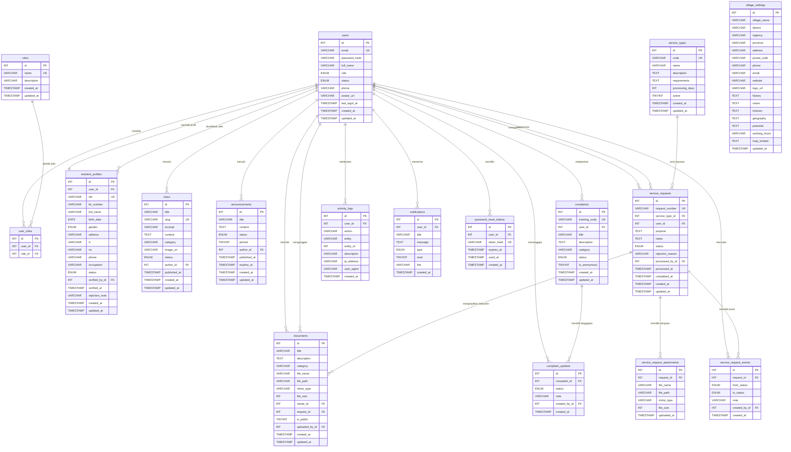

# ERD.md - Entity Relationship Diagram SIPEDES

Dokumen ini menjelaskan struktur basis data SIPEDES: daftar tabel, kolom, tipe data, relasi antar tabel, dan diagram Entity Relationship Diagram (ERD) menggunakan sintaks Mermaid.

Skema didefinisikan di file `database/migrations/mysql/001_initial_schema.sql` (untuk MySQL/InnoDB/utf8mb4). Versi SQLite tersedia di `database/migrations/sqlite/001_initial_schema.sql` dengan struktur tabel yang setara namun menggunakan tipe data SQLite.

---

## Daftar Isi

1. [Pendahuluan](#1-pendahuluan)
2. [Daftar Tabel](#2-daftar-tabel)
3. [Relasi Antar Tabel](#3-relasi-antar-tabel)
4. [Diagram ERD (Mermaid)](#4-diagram-erd-mermaid)
5. [Keterangan Diagram](#5-keterangan-diagram)
6. [Catatan Implementasi](#6-catatan-implementasi)

---

## 1. Pendahuluan

Basis data SIPEDES terdiri dari **17 tabel** yang merepresentasikan entitas-entitas berikut:

- **Autentikasi & otorisasi**: `users`, `roles`, `user_roles`, `password_reset_tokens`.
- **Profil warga**: `resident_profiles`.
- **Pengaturan desa**: `village_settings`.
- **Konten publik**: `news`, `announcements`.
- **Layanan surat**: `service_types`, `service_requests`, `service_request_attachments`, `service_request_events`.
- **Pengaduan**: `complaints`, `complaint_updates`.
- **Arsip dokumen**: `documents`.
- **Audit & notifikasi**: `activity_logs`, `notifications`.

### Konvensi Umum

- Semua tabel menggunakan engine **InnoDB** dengan charset `utf8mb4` (mendukung emoji & karakter multibyte).
- Primary key standar: `id INT AUTO_INCREMENT`.
- Timestamp standar: `created_at TIMESTAMP DEFAULT CURRENT_TIMESTAMP`, `updated_at TIMESTAMP DEFAULT CURRENT_TIMESTAMP ON UPDATE CURRENT_TIMESTAMP`.
- Soft delete: tidak digunakan; penghapusan bersifat fisik (hard delete) dengan `ON DELETE CASCADE`/`SET NULL` pada foreign key.
- Index dibuat pada kolom yang sering difilter (status, foreign key, kategori, dll.) untuk performa query.

---

## 2. Daftar Tabel

### 2.1 roles

Tabel daftar peran (master data). Saat ini berisi: `warga`, `petugas`, `admin`.

| Kolom | Tipe | Constraint | Deskripsi |
|-------|------|------------|-----------|
| `id` | INT | PK, AUTO_INCREMENT | Primary key. |
| `name` | VARCHAR(50) | NOT NULL, UNIQUE | Nama peran. |
| `description` | VARCHAR(255) | NULL | Deskripsi peran. |
| `created_at` | TIMESTAMP | NOT NULL, DEFAULT NOW | Waktu pembuatan. |
| `updated_at` | TIMESTAMP | NOT NULL, DEFAULT NOW ON UPDATE | Waktu update terakhir. |

### 2.2 users

Tabel utama akun pengguna.

| Kolom | Tipe | Constraint | Deskripsi |
|-------|------|------------|-----------|
| `id` | INT | PK, AUTO_INCREMENT | Primary key. |
| `email` | VARCHAR(191) | NOT NULL, UNIQUE | Email (login identifier). |
| `password_hash` | VARCHAR(255) | NOT NULL | Hash bcrypt kata sandi. |
| `full_name` | VARCHAR(150) | NOT NULL | Nama lengkap. |
| `role` | ENUM('warga','petugas','admin') | NOT NULL, DEFAULT 'warga' | Peran utama (untuk backward-compat). |
| `status` | ENUM('pending','active','rejected','disabled') | NOT NULL, DEFAULT 'pending' | Status akun. |
| `phone` | VARCHAR(30) | NULL | Nomor telepon. |
| `avatar_url` | VARCHAR(500) | NULL | URL foto profil. |
| `last_login_at` | TIMESTAMP | NULL | Login terakhir. |
| `created_at` | TIMESTAMP | NOT NULL, DEFAULT NOW | |
| `updated_at` | TIMESTAMP | NOT NULL, DEFAULT NOW ON UPDATE | |

Index: `idx_users_role`, `idx_users_status`.

### 2.3 user_roles

Tabel junction untuk multi-role (opsional, jika satu user bisa punya lebih dari satu peran).

| Kolom | Tipe | Constraint | Deskripsi |
|-------|------|------------|-----------|
| `id` | INT | PK, AUTO_INCREMENT | |
| `user_id` | INT | NOT NULL, FK -> users.id (CASCADE) | |
| `role_id` | INT | NOT NULL, FK -> roles.id (CASCADE) | |

Constraint: `UNIQUE (user_id, role_id)` - mencegah duplikasi pasangan user-role.

### 2.4 resident_profiles

Profil detail warga (data demografi & administratif).

| Kolom | Tipe | Constraint | Deskripsi |
|-------|------|------------|-----------|
| `id` | INT | PK, AUTO_INCREMENT | |
| `user_id` | INT | NOT NULL, FK -> users.id (CASCADE) | Relasi ke akun. |
| `nik` | VARCHAR(32) | NULL, UNIQUE | Nomor Induk Kependudukan. |
| `kk_number` | VARCHAR(32) | NULL | Nomor Kartu Keluarga. |
| `full_name` | VARCHAR(150) | NOT NULL | Nama lengkap (sesuai KTP). |
| `birth_date` | DATE | NULL | Tanggal lahir. |
| `gender` | ENUM('L','P') | NULL | Jenis kelamin. |
| `address` | VARCHAR(255) | NULL | Alamat lengkap. |
| `rt` | VARCHAR(5) | NULL | Rukun Tetangga. |
| `rw` | VARCHAR(5) | NULL | Rukun Warga. |
| `phone` | VARCHAR(30) | NULL | Telepon warga. |
| `occupation` | VARCHAR(100) | NULL | Pekerjaan. |
| `status` | ENUM('pending','active','rejected','disabled') | NOT NULL, DEFAULT 'pending' | Status verifikasi. |
| `verified_by_id` | INT | NULL, FK -> users.id (SET NULL) | Petugas/admin yang memverifikasi. |
| `verified_at` | TIMESTAMP | NULL | Waktu verifikasi. |
| `rejection_note` | VARCHAR(255) | NULL | Catatan penolakan. |
| `created_at` | TIMESTAMP | NOT NULL, DEFAULT NOW | |
| `updated_at` | TIMESTAMP | NOT NULL, DEFAULT NOW ON UPDATE | |

Index: `idx_resident_status`, `idx_resident_rt_rw`.

### 2.5 village_settings

Pengaturan identitas desa (singleton - hanya satu baris aktif).

| Kolom | Tipe | Constraint | Deskripsi |
|-------|------|------------|-----------|
| `id` | INT | PK, AUTO_INCREMENT | |
| `village_name` | VARCHAR(150) | NOT NULL | Nama desa. |
| `district` | VARCHAR(150) | NULL | Kecamatan. |
| `regency` | VARCHAR(150) | NULL | Kabupaten/Kota. |
| `province` | VARCHAR(150) | NULL | Provinsi. |
| `address` | VARCHAR(255) | NULL | Alamat kantor desa. |
| `postal_code` | VARCHAR(10) | NULL | Kode pos. |
| `phone` | VARCHAR(30) | NULL | Telepon desa. |
| `email` | VARCHAR(150) | NULL | Email desa. |
| `website` | VARCHAR(255) | NULL | Website resmi. |
| `logo_url` | VARCHAR(500) | NULL | URL logo. |
| `history` | TEXT | NULL | Sejarah desa. |
| `vision` | TEXT | NULL | Visi. |
| `mission` | TEXT | NULL | Misi. |
| `geography` | TEXT | NULL | Kondisi geografis. |
| `potential` | TEXT | NULL | Potensi desa. |
| `working_hours` | VARCHAR(255) | NULL | Jam kerja kantor. |
| `map_embed` | TEXT | NULL | Embed code peta (Google Maps). |
| `updated_at` | TIMESTAMP | NOT NULL, DEFAULT NOW ON UPDATE | |

### 2.6 news

Berita desa.

| Kolom | Tipe | Constraint | Deskripsi |
|-------|------|------------|-----------|
| `id` | INT | PK, AUTO_INCREMENT | |
| `title` | VARCHAR(255) | NOT NULL | Judul. |
| `slug` | VARCHAR(255) | NOT NULL, UNIQUE | Slug URL. |
| `excerpt` | VARCHAR(500) | NULL | Ringkasan. |
| `content` | TEXT | NOT NULL | Isi berita. |
| `category` | VARCHAR(100) | NULL | Kategori. |
| `image_url` | VARCHAR(500) | NULL | URL gambar. |
| `status` | ENUM('draft','published','archived') | NOT NULL, DEFAULT 'draft' | Status publikasi. |
| `author_id` | INT | NOT NULL, FK -> users.id (RESTRICT) | Penulis. |
| `published_at` | TIMESTAMP | NULL | Waktu publish. |
| `created_at` | TIMESTAMP | NOT NULL, DEFAULT NOW | |
| `updated_at` | TIMESTAMP | NOT NULL, DEFAULT NOW ON UPDATE | |

Index: `idx_news_status`, `idx_news_category`, `idx_news_published`.

### 2.7 announcements

Pengumuman desa.

| Kolom | Tipe | Constraint | Deskripsi |
|-------|------|------------|-----------|
| `id` | INT | PK, AUTO_INCREMENT | |
| `title` | VARCHAR(255) | NOT NULL | Judul. |
| `content` | TEXT | NOT NULL | Isi pengumuman. |
| `status` | ENUM('draft','published','archived') | NOT NULL, DEFAULT 'draft' | Status. |
| `pinned` | TINYINT(1) | NOT NULL, DEFAULT 0 | Pin ke atas (0/1). |
| `author_id` | INT | NOT NULL, FK -> users.id (RESTRICT) | Penulis. |
| `published_at` | TIMESTAMP | NULL | Waktu publish. |
| `expires_at` | TIMESTAMP | NULL | Kedaluwarsa otomatis. |
| `created_at` | TIMESTAMP | NOT NULL, DEFAULT NOW | |
| `updated_at` | TIMESTAMP | NOT NULL, DEFAULT NOW ON UPDATE | |

Index: `idx_announcement_status`, `idx_announcement_pinned`.

### 2.8 service_types

Master jenis layanan surat.

| Kolom | Tipe | Constraint | Deskripsi |
|-------|------|------------|-----------|
| `id` | INT | PK, AUTO_INCREMENT | |
| `code` | VARCHAR(50) | NOT NULL, UNIQUE | Kode unik (mis. SURAT_DOMISILI). |
| `name` | VARCHAR(150) | NOT NULL | Nama layanan. |
| `description` | TEXT | NULL | Deskripsi. |
| `requirements` | TEXT | NOT NULL | Persyaratan (multi-line). |
| `processing_days` | INT | NULL | Estimasi lama proses (hari). |
| `active` | TINYINT(1) | NOT NULL, DEFAULT 1 | Aktif/non-aktif. |
| `created_at` | TIMESTAMP | NOT NULL, DEFAULT NOW | |
| `updated_at` | TIMESTAMP | NOT NULL, DEFAULT NOW ON UPDATE | |

Index: `idx_service_type_active`.

### 2.9 service_requests

Permohonan layanan surat oleh warga.

| Kolom | Tipe | Constraint | Deskripsi |
|-------|------|------------|-----------|
| `id` | INT | PK, AUTO_INCREMENT | |
| `request_number` | VARCHAR(50) | NOT NULL, UNIQUE | Nomor permohonan (mis. REQ-2024-0001). |
| `service_type_id` | INT | NOT NULL, FK -> service_types.id (RESTRICT) | Jenis layanan. |
| `user_id` | INT | NOT NULL, FK -> users.id (CASCADE) | Pemohon. |
| `purpose` | TEXT | NOT NULL | Keperluan. |
| `notes` | TEXT | NULL | Catatan tambahan. |
| `status` | ENUM('diajukan','dalam_pemeriksaan','perlu_perbaikan','disetujui','ditolak','selesai') | NOT NULL, DEFAULT 'diajukan' | Status. |
| `rejection_reason` | VARCHAR(500) | NULL | Alasan penolakan. |
| `processed_by_id` | INT | NULL, FK -> users.id (SET NULL) | Petugas pemroses. |
| `processed_at` | TIMESTAMP | NULL | Waktu mulai diproses. |
| `completed_at` | TIMESTAMP | NULL | Waktu selesai. |
| `created_at` | TIMESTAMP | NOT NULL, DEFAULT NOW | |
| `updated_at` | TIMESTAMP | NOT NULL, DEFAULT NOW ON UPDATE | |

Index: `idx_request_status`, `idx_request_user`, `idx_request_type`.

### 2.10 service_request_attachments

Lampiran file pada permohonan.

| Kolom | Tipe | Constraint | Deskripsi |
|-------|------|------------|-----------|
| `id` | INT | PK, AUTO_INCREMENT | |
| `request_id` | INT | NOT NULL, FK -> service_requests.id (CASCADE) | Permohonan terkait. |
| `file_name` | VARCHAR(255) | NOT NULL | Nama asli file. |
| `file_path` | VARCHAR(500) | NOT NULL | Path penyimpanan. |
| `mime_type` | VARCHAR(100) | NOT NULL | Tipe MIME. |
| `file_size` | INT | NOT NULL | Ukuran (bytes). |
| `uploaded_at` | TIMESTAMP | NOT NULL, DEFAULT NOW | Waktu upload. |

Index: `idx_attachment_request`.

### 2.11 service_request_events

Riwayat perubahan status permohonan (audit trail).

| Kolom | Tipe | Constraint | Deskripsi |
|-------|------|------------|-----------|
| `id` | INT | PK, AUTO_INCREMENT | |
| `request_id` | INT | NOT NULL, FK -> service_requests.id (CASCADE) | |
| `from_status` | ENUM (6 value) | NULL | Status sebelum. |
| `to_status` | ENUM (6 value) | NOT NULL | Status sesudah. |
| `note` | VARCHAR(500) | NULL | Catatan perubahan. |
| `created_by_id` | INT | NOT NULL, FK -> users.id (RESTRICT) | Aktor perubahan. |
| `created_at` | TIMESTAMP | NOT NULL, DEFAULT NOW | |

Index: `idx_event_request`.

### 2.12 complaints

Pengaduan dari warga.

| Kolom | Tipe | Constraint | Deskripsi |
|-------|------|------------|-----------|
| `id` | INT | PK, AUTO_INCREMENT | |
| `tracking_code` | VARCHAR(50) | NOT NULL, UNIQUE | Kode tracking (mis. CMP-2024-0001). |
| `user_id` | INT | NOT NULL, FK -> users.id (CASCADE) | Pelapor. |
| `title` | VARCHAR(255) | NOT NULL | Judul. |
| `description` | TEXT | NOT NULL | Deskripsi. |
| `category` | VARCHAR(100) | NULL | Kategori. |
| `status` | ENUM('baru','diterima','diproses','selesai','ditutup') | NOT NULL, DEFAULT 'baru' | Status. |
| `is_anonymous` | TINYINT(1) | NOT NULL, DEFAULT 0 | Anonim (sembunyikan nama). |
| `created_at` | TIMESTAMP | NOT NULL, DEFAULT NOW | |
| `updated_at` | TIMESTAMP | NOT NULL, DEFAULT NOW ON UPDATE | |

Index: `idx_complaint_status`, `idx_complaint_user`, `idx_complaint_category`.

### 2.13 complaint_updates

Riwayat tanggapan terhadap pengaduan.

| Kolom | Tipe | Constraint | Deskripsi |
|-------|------|------------|-----------|
| `id` | INT | PK, AUTO_INCREMENT | |
| `complaint_id` | INT | NOT NULL, FK -> complaints.id (CASCADE) | |
| `status` | ENUM (5 value) | NOT NULL | Status baru. |
| `note` | VARCHAR(500) | NULL | Catatan petugas. |
| `created_by_id` | INT | NOT NULL, FK -> users.id (RESTRICT) | Aktor. |
| `created_at` | TIMESTAMP | NOT NULL, DEFAULT NOW | |

Index: `idx_update_complaint`.

### 2.14 documents

Arsip dokumen desa.

| Kolom | Tipe | Constraint | Deskripsi |
|-------|------|------------|-----------|
| `id` | INT | PK, AUTO_INCREMENT | |
| `title` | VARCHAR(255) | NOT NULL | Judul. |
| `description` | TEXT | NULL | Deskripsi. |
| `category` | VARCHAR(100) | NULL | Kategori. |
| `file_name` | VARCHAR(255) | NOT NULL | Nama asli. |
| `file_path` | VARCHAR(500) | NOT NULL | Path penyimpanan. |
| `mime_type` | VARCHAR(100) | NOT NULL | Tipe MIME. |
| `file_size` | INT | NOT NULL | Ukuran (bytes). |
| `owner_id` | INT | NULL, FK -> users.id (SET NULL) | Pemilik (jika privat). |
| `request_id` | INT | NULL, FK -> service_requests.id (SET NULL) | Permohonan terkait. |
| `is_public` | TINYINT(1) | NOT NULL, DEFAULT 0 | Publik/privat. |
| `uploaded_by_id` | INT | NOT NULL, FK -> users.id (RESTRICT) | Pengunggah. |
| `created_at` | TIMESTAMP | NOT NULL, DEFAULT NOW | |
| `updated_at` | TIMESTAMP | NOT NULL, DEFAULT NOW ON UPDATE | |

Index: `idx_document_category`, `idx_document_owner`, `idx_document_public`.

### 2.15 activity_logs

Audit log aktivitas administratif.

| Kolom | Tipe | Constraint | Deskripsi |
|-------|------|------------|-----------|
| `id` | INT | PK, AUTO_INCREMENT | |
| `user_id` | INT | NULL, FK -> users.id (SET NULL) | Aktor. |
| `action` | VARCHAR(100) | NOT NULL | Kode aksi (mis. UPDATE_VILLAGE_SETTINGS). |
| `entity` | VARCHAR(100) | NULL | Entitas terdampak. |
| `entity_id` | INT | NULL | ID entitas. |
| `description` | VARCHAR(500) | NULL | Deskripsi. |
| `ip_address` | VARCHAR(45) | NULL | IP aktor. |
| `user_agent` | VARCHAR(500) | NULL | User-Agent browser. |
| `created_at` | TIMESTAMP | NOT NULL, DEFAULT NOW | |

Index: `idx_log_user`, `idx_log_entity`, `idx_log_created`.

### 2.16 notifications

Notifikasi in-app untuk pengguna.

| Kolom | Tipe | Constraint | Deskripsi |
|-------|------|------------|-----------|
| `id` | INT | PK, AUTO_INCREMENT | |
| `user_id` | INT | NOT NULL, FK -> users.id (CASCADE) | Penerima. |
| `title` | VARCHAR(255) | NOT NULL | Judul. |
| `message` | TEXT | NOT NULL | Isi pesan. |
| `type` | ENUM('info','success','warning','error') | NOT NULL, DEFAULT 'info' | Jenis. |
| `read` | TINYINT(1) | NOT NULL, DEFAULT 0 | Sudah dibaca (0/1). |
| `link` | VARCHAR(500) | NULL | URL tujuan (opsional). |
| `created_at` | TIMESTAMP | NOT NULL, DEFAULT NOW | |

Index: `idx_notification_user_read` (composite: user_id, read).

### 2.17 password_reset_tokens

Token reset kata sandi (untuk fitur lupa password di masa depan).

| Kolom | Tipe | Constraint | Deskripsi |
|-------|------|------------|-----------|
| `id` | INT | PK, AUTO_INCREMENT | |
| `user_id` | INT | NOT NULL, FK -> users.id (CASCADE) | |
| `token_hash` | VARCHAR(255) | NOT NULL, UNIQUE | Hash token (bukan plain). |
| `expires_at` | TIMESTAMP | NOT NULL | Kedaluwarsa. |
| `used_at` | TIMESTAMP | NULL | Waktu dipakai (null = belum). |
| `created_at` | TIMESTAMP | NOT NULL, DEFAULT NOW | |

Index: `idx_reset_token`.

---

## 3. Relasi Antar Tabel

Berikut daftar foreign key lengkap beserta aksi ON DELETE.

| Tabel Anak | Kolom FK | Tabel Induk | Kolom Tujuan | ON DELETE | Deskripsi |
|------------|----------|-------------|--------------|-----------|-----------|
| user_roles | user_id | users | id | CASCADE | User dihapus -> hapus relasi rolenya. |
| user_roles | role_id | roles | id | CASCADE | Role dihapus -> hapus relasi user-nya. |
| resident_profiles | user_id | users | id | CASCADE | User dihapus -> hapus profilnya. |
| resident_profiles | verified_by_id | users | id | SET NULL | Verifikator dihapus -> set null (riwayat tetap). |
| news | author_id | users | id | RESTRICT | Tidak boleh hapus user yang masih punya berita. |
| announcements | author_id | users | id | RESTRICT | Tidak boleh hapus user yang masih punya pengumuman. |
| service_requests | service_type_id | service_types | id | RESTRICT | Tidak boleh hapus jenis layanan yang masih dipakai. |
| service_requests | user_id | users | id | CASCADE | User dihapus -> hapus permohonannya. |
| service_requests | processed_by_id | users | id | SET NULL | Petugas dihapus -> set null (riwayat tetap). |
| service_request_attachments | request_id | service_requests | id | CASCADE | Permohonan dihapus -> hapus lampirannya. |
| service_request_events | request_id | service_requests | id | CASCADE | Permohonan dihapus -> hapus event-nya. |
| service_request_events | created_by_id | users | id | RESTRICT | Tidak boleh hapus user yang masih dirujuk event. |
| complaints | user_id | users | id | CASCADE | User dihapus -> hapus pengaduannya. |
| complaint_updates | complaint_id | complaints | id | CASCADE | Pengaduan dihapus -> hapus update-nya. |
| complaint_updates | created_by_id | users | id | RESTRICT | Tidak boleh hapus user yang masih dirujuk update. |
| documents | owner_id | users | id | SET NULL | Pemilik dihapus -> dokumen tetap (owner null). |
| documents | request_id | service_requests | id | SET NULL | Permohonan dihapus -> dokumen tetap (request null). |
| documents | uploaded_by_id | users | id | RESTRICT | Tidak boleh hapus user yang masih upload dokumen. |
| activity_logs | user_id | users | id | SET NULL | User dihapus -> log tetap (user null). |
| notifications | user_id | users | id | CASCADE | User dihapus -> hapus notifikasinya. |
| password_reset_tokens | user_id | users | id | CASCADE | User dihapus -> hapus token reset-nya. |

### Kardinalitas dalam Teks

- `users` **1 : N** `user_roles` (satu user bisa punya beberapa role)
- `users` **1 : 1** `resident_profiles` (satu user warga punya satu profil)
- `users` **1 : N** `news` (sebagai author)
- `users` **1 : N** `announcements` (sebagai author)
- `users` **1 : N** `service_requests` (sebagai pemohon)
- `users` **1 : N** `service_requests` (sebagai processed_by)
- `users` **1 : N** `service_request_events` (sebagai created_by)
- `users` **1 : N** `complaints` (sebagai pelapor)
- `users` **1 : N** `complaint_updates` (sebagai created_by)
- `users` **1 : N** `documents` (sebagai owner, uploader)
- `users` **1 : N** `activity_logs` (sebagai aktor)
- `users` **1 : N** `notifications` (sebagai penerima)
- `users` **1 : N** `password_reset_tokens`
- `users` **1 : N** `resident_profiles` (sebagai verified_by)
- `roles` **1 : N** `user_roles`
- `service_types` **1 : N** `service_requests`
- `service_requests` **1 : N** `service_request_attachments`
- `service_requests` **1 : N** `service_request_events`
- `service_requests` **1 : N** `documents` (dokumen hasil permohonan)
- `complaints` **1 : N** `complaint_updates`

---

## 4. Diagram ERD (Mermaid)

Diagram berikut menggunakan sintaks `erDiagram` Mermaid. Diagram ini dapat dirender oleh GitHub, GitLab, VS Code (dengan extension Mermaid), atau https://mermaid.live.

---

## 5. Keterangan Diagram

### Notasi Kardinalitas Mermaid

| Simbol | Arti |
|--------|------|
| `||--||` | One to One (wajib di kedua sisi) |
| `||--o{` | One to Many (wajib di sisi kiri, opsional di kanan) |
| `}o--o{` | Many to Many (opsional di kedua sisi) |
| `||--o|` | One to Zero-or-One |

Pada diagram di atas, mayoritas relasi menggunakan `||--o{` (satu user bisa punya banyak entitas anak, tetapi tidak wajib).

### Pembacaan Relasi

Contoh: `users ||--o{ news : "menulis"`
- **Artinya**: Satu `users` bisa menulis banyak `news` (1:N).
- Foreign key `news.author_id` mengarah ke `users.id`.
- ON DELETE `RESTRICT`: user tidak bisa dihapus jika masih memiliki berita.

### Tabel Mandiri

`village_settings` adalah tabel **singleton** - hanya ada satu baris aktif. Tidak memiliki foreign key ke tabel lain. Diakses via `GET /api/v1/village` (publik) dan `PUT /api/v1/village` (staff).

---

## 6. Catatan Implementasi

### 6.1 Pemilihan Tipe Data

- `VARCHAR(191)` untuk email pada `users`: batas aman untuk index InnoDB dengan utf8mb4 (191 * 4 = 764 bytes < 767 bytes limit pada MySQL lama).
- `TEXT` untuk konten panjang (berita, deskripsi, sejarah desa).
- `ENUM` untuk field dengan nilai tetap (status, role, gender). Keuntungan: validasi di level database, hemat storage. Kerugian: perlu ALTER TABLE untuk menambah nilai.
- `TINYINT(1)` untuk boolean (kompatibel dengan praktik MySQL umum).
- `TIMESTAMP` untuk datetime (range 1970-2038, cukup untuk aplikasi ini).

### 6.2 Index Strategy

Index dibuat pada kolom yang:
1. Sering difilter di WHERE clause (status, category, role).
2. Foreign key (untuk perfomance JOIN).
3. Composite index pada query gabungan (mis. `idx_notification_user_read` pada `(user_id, read)` untuk query "notifikasi belum dibaca user X").

### 6.3 Cascade vs Restrict

- **CASCADE**: untuk data yang "tidak berguna tanpa induk" (mis. `service_request_attachments` tanpa `service_requests`). Menghapus induk otomatis menghapus anak.
- **SET NULL**: untuk data yang "tetap ada tapi kehilangan referensi" (mis. `activity_logs` tanpa user - log tetap berguna untuk audit).
- **RESTRICT**: untuk mencegah penghapusan yang akan menyebabkan orphan data yang tidak diinginkan (mis. `news` tanpa `author` - riwayat penulis harus tetap utuh).

### 6.4 Kompatibilitas SQLite

Versi SQLite dari skema (`database/migrations/sqlite/001_initial_schema.sql`) memiliki struktur tabel yang setara dengan adaptasi berikut:
- `AUTO_INCREMENT` -> `AUTOINCREMENT`.
- `ENUM` -> `TEXT` dengan `CHECK (col IN ('a','b','c'))`.
- `TINYINT(1)` -> `INTEGER` (0/1).
- `TIMESTAMP DEFAULT CURRENT_TIMESTAMP ON UPDATE CURRENT_TIMESTAMP` -> trigger terpisah atau di-handle di application layer.
- `ENGINE=InnoDB DEFAULT CHARSET=utf8mb4` dihapus.

### 6.5 Seed Data

Seed (`npm run db:seed`) mengisi:
- 1 baris `village_settings` (Desa Contoh).
- 3 baris `roles` (warga, petugas, admin).
- 7 baris `users` (1 admin, 1 petugas, 5 warga dengan berbagai status).
- 7 baris `resident_profiles` (1:1 dengan users warga).
- 5 baris `service_types` (domisili, pengantar, usaha, SKTM, penghasilan).
- 5+ baris `news` (3 published, 2 draft).
- 3+ baris `announcements`.
- Beberapa `documents` contoh.

---

## Referensi

- File migration MySQL: `database/migrations/mysql/001_initial_schema.sql`.
- File migration SQLite: `database/migrations/sqlite/001_initial_schema.sql`.
- File seed: `apps/api/src/scripts/seed.ts`.
- [API.md](./API.md) - dokumentasi endpoint yang menggunakan tabel-tabel di atas.
- [SETUP.md](./SETUP.md) - cara menjalankan migration & seed.

---

**Akhir dokumen ERD.**
